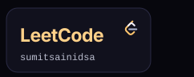
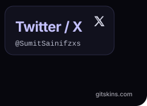
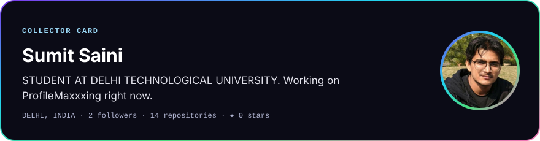
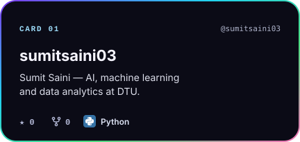
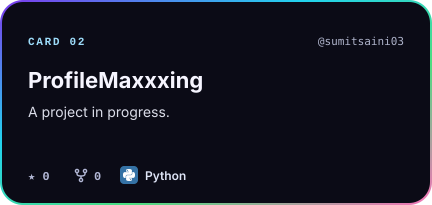
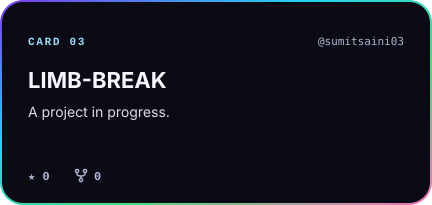
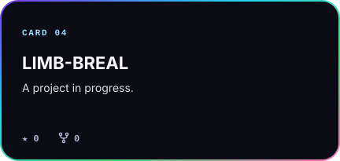
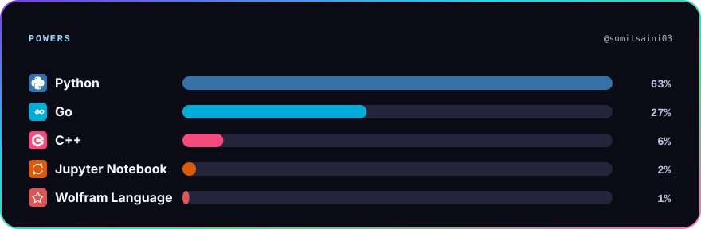
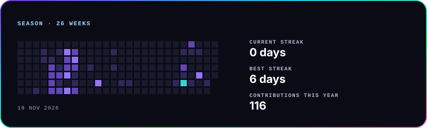

<!-- Each linked tile occupies its own region of the 880 × 460 illustration. Keep neighboring image tags adjacent. -->

   
   
  

  

  
  
   
  
  

  

  

<strong>Explore my AI and analytics projects</strong>

I study at Delhi Technological University and build projects in machine learning, retrieval, and data analysis.

| Project | What you can inspect |
| --- | --- |
| [Telecom Retention Intelligence](https://github.com/sumitsaini03/Telecom-Retention-Intelligence) | A churn model evaluated on 1,409 held-out customers, with a reported ROC-AUC of 0.8465. The repository includes SHAP explanations and SQL analysis. |
| [VoiceOps / ZentroMart](https://github.com/sumitsaini03/VoiceOps-2026-ZentroMart) | A customer-support agent that retrieves store policies, verifies orders, and hands uncertain cases to a person. |
| [CyberSecMax](https://github.com/sumitsaini03/CyberSecMax) | A reproducible QLoRA experiment for defensive cybersecurity. The data checks and evaluation protocol are implemented. Training and benchmark results are pending. |

[All repositories](https://github.com/sumitsaini03?tab=repositories) · [LinkedIn](https://www.linkedin.com/in/sumit-saini-2711b83b0/) · [LeetCode](https://leetcode.com/u/sumitsainidsa/) · [X](https://x.com/SumitSainifzxs)

© 2026 Sumit Saini · <a href="./COPYRIGHT.md">Artwork and reuse</a> · Holo Card inspired by <a href="https://www.gitskins.com/readme-generator">GitSkins</a>
