  

# Sumit Saini

**AI / Machine learning / Data analytics · Delhi Technological University · Delhi, India**

[Selected projects](#selected-projects) &nbsp; / &nbsp; [My toolkit](#my-toolkit) &nbsp; / &nbsp; [More experiments](#more-experiments) &nbsp; / &nbsp; [GitHub](https://github.com/sumitsaini03)

I build projects that connect **data, models, and useful decisions**: churn analysis with model explanations, policy-grounded conversational agents, and reproducible LLM experiments. I'm a student at **Delhi Technological University**, developing my work across AI/ML and analytics.

I care about the full path: preparing the data, evaluating the model, explaining the result, and making the work reproducible.

## Selected projects

### Telecom Retention Intelligence

An end-to-end analytics project on the IBM Telco sample: data validation, customer segmentation, logistic regression and XGBoost comparison, TreeSHAP explanations, and PostgreSQL analysis.

- **Evidence:** repository-reported XGBoost ROC-AUC of **0.8465** on **1,409 held-out customers**. Threshold selection uses training out-of-fold predictions.
- **Engineering:** a reusable inference pipeline, data-quality checks, SQL/Pandas parity checks, and documented evaluation artifacts.
- **Scope:** an observational portfolio project; results do not establish campaign impact. Power BI report files are implemented, with Desktop rendering and refresh still unverified.

[Explore the repository](https://github.com/sumitsaini03/Telecom-Retention-Intelligence) · [Inspect evaluation results](https://github.com/sumitsaini03/Telecom-Retention-Intelligence/blob/main/outputs/metrics.json)

<strong>See the project's analysis outputs</strong>

These are the project's saved Python analysis outputs. SHAP describes model associations, not causal effects.

### VoiceOps / ZentroMart

A customer-support agent built for the **IIT Guwahati Consulting & Analytics Club × Gnani.ai capstone**. It combines policy-aware retrieval, conversation state, order-verification gates, and escalation logic across text and voice interfaces.

- **What matters:** current policies take precedence over superseded documents; low-evidence questions have a handover path.
- **Built with:** Python, TF-IDF retrieval, modular agent logic, and Gnani speech integration.
- **Scope:** live speech requires configured provider credentials.

[Explore the agent](https://github.com/sumitsaini03/VoiceOps-2026-ZentroMart) · [Read the retrieval implementation](https://github.com/sumitsaini03/VoiceOps-2026-ZentroMart/blob/main/src/retrieval.py)

### CyberSecMax

A reproducible **defensive cybersecurity QLoRA experiment pipeline** for Qwen2.5-7B-Instruct. The project prepares baseline comparison, data validation, contamination checks, checkpoint recovery, and paired evaluation under a frozen CyberMetric-500 protocol.

**Status: experiment implementation, pending execution.** No completed training run, trained adapter, or benchmark improvement is claimed.

[Explore the experiment](https://github.com/sumitsaini03/CyberSecMax) · [Read the verification report](https://github.com/sumitsaini03/CyberSecMax/blob/main/VERIFICATION_REPORT.md)

## My toolkit

**Data:** Python, SQL, Pandas, NumPy, PostgreSQL  
**ML & evaluation:** scikit-learn, XGBoost, SHAP  
**Applied AI:** retrieval, conversational agents, llama.cpp, GGUF  
**Engineering:** Git, testing, APIs, Go

## More experiments

| Project | What to explore |
| --- | --- |
| [Local LLM Lab](https://github.com/sumitsaini03/local-llm-lab) | A Python text rewriter connected to a locally hosted quantized model through llama.cpp. |
| [TaskQueue](https://github.com/sumitsaini03/task_queue) | Go systems work: a concurrent queue with write-ahead logging, retries, scheduling, and metrics. |
| [LeetCode solutions](https://github.com/sumitsaini03/leetcode-solutions) | C++ problem-solving practice. |

<strong>How I approach a project</strong>

1. Start with a question the data or system can actually answer.
2. Build a reproducible path from input to result.
3. Separate measured evidence from assumptions and planned work.
4. Document the limits so someone else can evaluate and extend it.

 

<a href="https://github.com/sumitsaini03?tab=repositories"><strong>Explore all my repositories</strong></a> &nbsp; · &nbsp; <a href="https://github.com/sumitsaini03">Follow my work</a>

